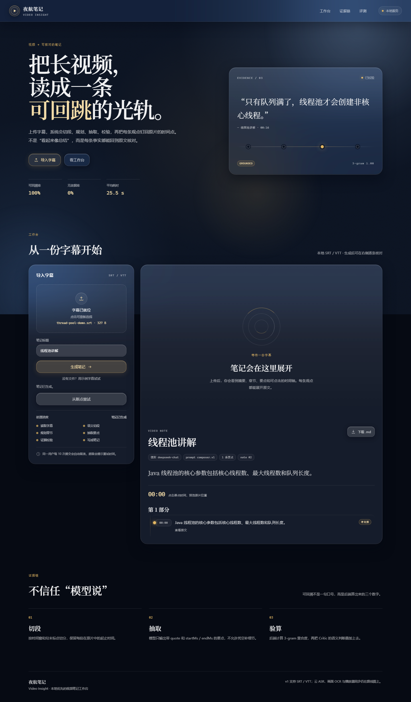
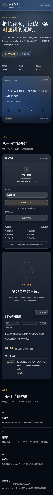

# Video Insight

把长视频变成**每条要点都能回跳原片时间点**的 Markdown 笔记。

> 当前状态：T1–T7 + 前端工作台已完成（解析 → 切段 → 四步 Agent → 证据校验 → 成稿 → API → 评测/限流 → 夜航玻璃界面）。
> 播放器同步与 ASR/OCR 还在路线图上。

## 为什么做这个

普通视频总结最大的问题不是“写得不顺”，而是**无法核对**：模型说视频里讲了某件事，
你没法快速确认它是不是编的。这个项目把“可回溯”做成后端可验算的约束：

- 每条要点必须带 `[startMs, endMs]`
- 引用必须能在该时间区间的原文里找到
- 用 3-gram 重合度计算证据强度，低于阈值直接剔除
- Critic 再做一层语义审查；Critic 不可用时全部降级为“模型推断”

## 界面

启动应用后打开 <http://localhost:8080/>。页面使用夜航玻璃拟态：深墨夜景、柔和光源、无色玻璃、香槟金单一强调色，以及一条可点击的“证据光轨”。





想直接看一次完整流程，打开 <http://localhost:8080/?demo=1>，页面会自动提交内置示例字幕。

## 当前能力

- SRT / VTT 字幕解析：BOM、乱序、多行、缺序号、`\r\n` 混用
- 时间窗 + 语义边界切段：软上限 75s、硬上限 120s、停顿 800ms、短段合并
- Agent 四步：Planner / Extractor / Critic / Composer
- 证据校验：`GROUNDED / INFERRED / REJECTED` 三档 + 滑动窗口
- 质量门槛：可回溯率低于 40% 不落库
- RocketMQ 异步：幂等抢占、阶段 checkpoint、1s/5s/30s 重试、死信、补偿投递
- 阶段产物落 MySQL `video_artifact`（JSON），键带 pipeline 版本
- FakeLLM 离线测试 + OpenAI 兼容 HTTP 适配器（DeepSeek / Qwen / GLM）
- HTTP API：上传字幕、查询任务、取笔记 JSON、下载 Markdown、失败重试
- 评测接口：引用可回溯率、无依据率、平均端到端耗时
- Redis 令牌桶限流：Lua 原子扣减，超限返回 429 + `Retry-After`

## 架构

```text
SRT/VTT
  │
  ▼
FETCHING ──► SEGMENTING ──► PLANNING ──► EXTRACTING ──► VERIFYING ──► COMPOSING
   │             │             │             │             │             │
   └─────────────┴─────────────┴──── video_artifact ───────┴─────────────┘
                                      (MySQL JSON)

RocketMQ: video-task 主题
  消费幂等：UPDATE ... WHERE status = 'PENDING' / 'FAILED'
  失败重试：1s → 5s → 30s → 死信
  PENDING 超过 60s：补偿任务重新投递
```

## 技术栈

- Java 25 + Spring Boot 4.1.1
- MySQL 8（JPA + `JdbcTemplate` 读写 JSON artifact）
- RocketMQ 5.5.1（经典客户端）
- Redis（令牌桶；无 Redis 时可用内存实现）
- 前端：原生 HTML / CSS / JavaScript，无构建链
- Jackson 3
- JUnit 5 + AssertJ + H2（测试）

## 快速开始

### 1. 数据库

```sql
CREATE DATABASE video_insight CHARACTER SET utf8mb4 COLLATE utf8mb4_0900_ai_ci;
```

应用启动时会执行 `src/main/resources/schema.sql`，建五张表。

### 2. RocketMQ

```powershell
$env:ROCKETMQ_HOME='D:\Code\tools\rmq\rocketmq-all-5.5.1-bin-release'
bin\mqnamesrv.cmd -n 127.0.0.1:9876
bin\mqbroker.cmd -n 127.0.0.1:9876 -c conf\broker-local.conf
```

### 3. 环境变量

```powershell
$env:DB_PASSWORD='你的 MySQL 密码'
$env:MQ_ENABLED='true'
$env:LLM_PROVIDER='fake'          # 本地演示；真实模型用 http
$env:RATE_LIMIT_MODE='memory'     # 有 Redis 时用 redis
# $env:RATE_LIMIT_CAPACITY='10'
# $env:RATE_LIMIT_REFILL='2'
# $env:LLM_BASE_URL='https://api.deepseek.com'
# $env:LLM_API_KEY='...'
# $env:LLM_MODEL='deepseek-chat'
```

### 4. 测试与运行

```powershell
$env:JAVA_HOME='D:\IntelliJ IDEA 2026.1\jbr'
$env:Path = "C:\Windows\System32;C:\Windows;" + $env:Path

# 单元 / 集成测试
& 'D:\IntelliJ IDEA 2026.1\plugins\maven\lib\maven3\bin\mvn.cmd' -B test

# 打包运行
& 'D:\IntelliJ IDEA 2026.1\plugins\maven\lib\maven3\bin\mvn.cmd' -B -DskipTests package
java -jar target\video-insight-0.0.1-SNAPSHOT.jar
```

上传字幕并生成笔记：

```powershell
$form = @{
  file  = Get-Item 'data\demo.srt'
  title = '线程池讲解'
}
$task = Invoke-RestMethod -Uri 'http://127.0.0.1:8080/api/tasks' -Method Post -Form $form
$task.id

# 轮询状态，DONE 后取笔记
Invoke-RestMethod -Uri "http://127.0.0.1:8080/api/tasks/$($task.id)/note"
Invoke-WebRequest -Uri "http://127.0.0.1:8080/api/tasks/$($task.id)/note.md" -OutFile note.md
```

评测：

```powershell
.\tools\eval\run.ps1 -BaseUrl 'http://127.0.0.1:8080'
```

可选的真中间件验证：

```powershell
$env:MQ_SMOKE='true'; mvn -Dtest=RocketMqSmokeTest test
$env:MYSQL_IT='true'; mvn -Dtest=MysqlArtifactStoreIT test
```

## 证据校验

| 3-gram 重合度 | 结果 | 处理 |
| --- | --- | --- |
| ≥ 0.6 且 Critic 通过 | `GROUNDED` | 进正文，可回跳原片 |
| 0.3 ~ 0.6 | 同区间滑动窗口再找 | 仍 < 0.6 → `INFERRED`，标注“模型推断” |
| < 0.3 或区间不存在 | `REJECTED` | 不进正文，进“未通过校验” |
| Critic 不可用 | 非 REJECTED 全部降为 `INFERRED` | 不把未审内容当事实 |

## 测试状态

- `mvn test`：44 项通过，0 失败，1 项可选 MQ 冒烟默认跳过
- 真 RocketMQ 冒烟：通过
- MySQL JSON artifact 集成测试：通过
- 手工端到端：任务 `DONE`，六个 artifact 落库，NOTE 首条要点 `GROUNDED / overlap=1.0`

## 回退

里程碑固定为：

- 分支：`milestone/frontend-2026-10-19`
- 标签：`milestone-frontend-2026-10-19`

```powershell
git fetch --tags
git switch -c rollback/frontend milestone-frontend-2026-10-19
```

把 `main` 强制拉回该点前请先备份分支，详见 [CHANGELOG.md](CHANGELOG.md)。

## Roadmap

- 前端：原生 HTML/CSS/JS + 播放器时间戳跳转
- 输入：云 ASR（无字幕时）、B 站字幕适配器、画面 OCR（后续）

## 说明

v1 只支持本地 SRT/VTT 文件；ASR、OCR、B 站抓取都还没实现。
没有 API 之前，可以通过数据库任务 + RocketMQ 消息做端到端验证。
